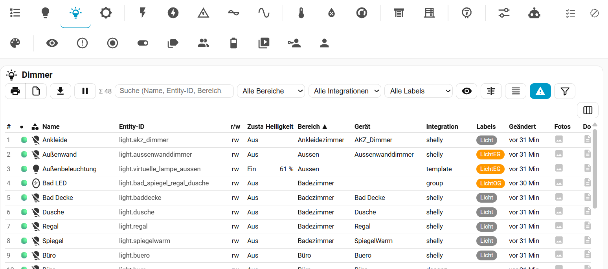
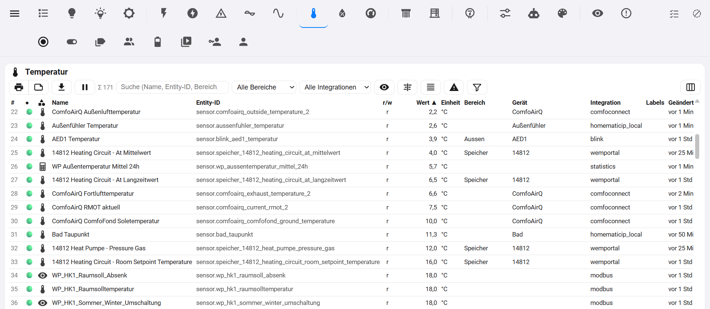

# Entity Inventory for Home Assistant

One overview of **every entity in your smart home**, sorted by type – with live values, units, read / write access, photos, documents, comments and a printable documentation.
Made for installations with thousands of entities, where nobody remembers any more *which sensor measures what, where it sits and which contract or manual belongs to it*.

**Deutsche Bedienungsanleitung:** siehe [unten](#bedienungsanleitung-deutsch).

Sister project of [Device Inventory](https://github.com/AlphaLima/ha-device-inventory): the same look, the same column editor, the same print layout, the same phone behaviour – Device Inventory lists the **devices**, Entity Inventory lists the **entities**.

## Screenshot

The *Dimmer* tab: tabs in groups on top (light, electrical, climate, blinds, consumption, automation, more), toolbar with search, area / integration / label selectors and the buttons for hidden entities, alignment, row spacing, unavailable entities, comment / photo filter and the column editor. Status LED, entity symbol, name, entity ID, read / write access (`r/w`), state, brightness, area, device, integration, coloured labels, last change and the photo / document / comment columns.

The *Temperature* tab with 171 sensors, sorted by value: the value (decimal separators lined up), the unit in its own column, area, device, integration and the time of the last change. Cells that are cut off show their full text as a tooltip.

## What you get

- **One tab per type, in groups:** *All & light* (all entities, lights, dimmers, brightness) · *Electrical* (power, energy, voltage, current, frequency) · *Climate* (temperature, humidity, thermostats) · *Blinds* (covers, slats) · *Consumption* (gas, water, volume) · *Automation* (automations & scripts, scenes, helpers: `input_*`, counters, timers, schedules and the helper integrations such as group, threshold, utility meter, statistics) · *More* (switches, batteries, media players, persons, user accounts, binary sensors, trackers, labels, other sensors, unavailable). Tabs without entries are not shown, the others carry a red badge for unavailable entities. A dialog switches single tabs on and off (kept in your browser).
- **The right columns per tab:** covers show position and slat angle, lights the brightness, thermostats current / target / mode / action, sensors value and unit in separate columns, …
- **Values lined up properly:** decimal separators sit exactly below each other (or left / right aligned – one button; with the decimal alignment missing zeros are added on the right, so `236,0` and `1,20` become `236,00` and `1,20`), units form their own column, sorting by value *or* by unit (SI prefixes are understood: mW < W < kW).
- **Click behaviour like Home Assistant:** value → history dialog, symbol → entity settings, device / integration / area → the matching Home Assistant page, label → label dialog, name / entity ID → rename dialog (name and entity ID, with a warning about automations that use the old ID).
- **Photos, documents and comments per entity:** several photos (hover preview, gallery), documents of any file type up to 25 MB (electricity contract, gas contract, manual, picture of the meter …; PDFs and images open in the browser), a comment text that the search also finds. Stored on the server (`.storage/entity_inventory`, `config/entity_inventory/<entity_id>/`): shared by all users and part of your backups. Renaming an entity ID takes everything along.
- **State class dialog:** a click on the state class explains it (`measurement`, `total`, `total_increasing`), shows whether Home Assistant keeps long-term statistics for the entity (hourly values for the Energy dashboard) and links to *Developer tools → Statistics*. The state class itself is set by the integration and cannot be changed here.
- **Access column `r/w`:** read-only (`r`), write-only (`w`) or both (`rw`) per entity.
- **Entity symbol** in its own column; a click opens a dialog to change it.
- **Hidden / disabled tab:** every entity that is hidden or switched off (disabled entities have no state and are read from the entity registry; administrators only), with a column that tells which. The rename dialog hides / shows an entity and switches it on / off (`hidden_by`, `disabled_by`); the toolbar button *show hidden / disabled entities* adds them to the other tabs.
- **Multiple selection:** a toolbar button switches on a checkbox column (shift-click selects a range, the checkbox in the heading selects everything shown). A bar offers *hide / show*, *switch on / off* and *recorder retention* for all selected entities at once; every action asks first and states the number and the consequences. Administrators only.
- **Labels and scenes:** a labels column with the coloured Home Assistant labels, a tab with every labelled entity, a selector to show only one label (or *without label*), a tab with scenes and their last activation.
- **User accounts tab:** all Home Assistant accounts with user name, role, login provider and linked person (administrators only).
- **Filters:** search over name, ID, area, device, integration, comments and document names; area, integration and label selectors; buttons to hide unavailable / hidden entities and to show only entries that have a comment or a photo.
- **Your own columns:** show / hide, drag and drop to reorder, width (also narrower than the content), own column names – separately for the **screen** and for the **printout**.
- **Print / PDF documentation** of exactly what you see (portrait or landscape, symbol and page number in the heading, photos and comments included) and **CSV export**.
- **Recorder columns (switch in the toolbar):** how long each entity is really stored in the recorder database (*stored for*), the number of entries, the average interval between two entries and the time of the last report (`last_updated`). They are read with one aggregate query and cached for five minutes; the columns sit behind the unit and help to get a feeling for which entities create the most data.
- **Recorder retention per entity and for all:** a dialog (from the *Recorder* column or the rename dialog) shows the global `purge_keep_days` of the recorder, how long the entity is stored and how many entries it has, lets you set a retention per entity and a default for all entities without a rule, and explains what to change in `configuration.yaml` to keep data longer (Home Assistant has no per-entity retention or sampling rate; a rule can only shorten the global retention). A nightly job (03:20, **off by default**) deletes older history with `recorder.purge_entities`; a preview shows entities and rows before anything is deleted, every step that switches the job on or deletes data asks for confirmation and explains what happens. Long-term statistics are never touched.
- **Blur sensitive data:** one button blurs user IDs, user names, trackers, persons and comments on screen and scrambles them in the printout – for screenshots and for publishing.
- **Comfort:** copy buttons for name, entity ID and value (appear on hover), the full text as tooltip when a cell is cut off, wider / tighter row spacing, live pause button, fast even with thousands of rows.
- **Back button:** opening a device, integration, person or label page from the table remembers the panel, so *Back* returns to it.
- **Phone friendly:** the tab bar slides away while you scroll the list and comes back when you pull down at the top – exactly like Device Inventory.

Everything is computed live in the browser from `hass.states` and the entity / device / area / label registry. The server part registers the panel, stores comments, photos and documents, and – for the recorder features – reads the recorder database (read-only aggregate queries) and calls `recorder.purge_entities` for the retention job. Changes (rename, symbol, labels, retention) need an administrator.

> Status: **v0.x – test versions.** The recorder retention is new and the most delicate part (it deletes data, but only when you switch the nightly job on or press *Run now*): try the preview first. In daily use on the author's system (Home Assistant **2026.11**, several thousand entities). It needs Home Assistant 2024.7 or newer but has so far only been tested on 2026.11. Please report problems as an [issue](https://github.com/AlphaLima/ha-entity-inventory/issues) with your Home Assistant version.

**Languages:** English, German, French, Spanish, Dutch, Italian, Polish, Portuguese, Czech, Russian, Swedish, Norwegian, Danish and Afrikaans (taken from the language of the logged-in user; every other language shows English). All languages except English and German are machine translations – corrections as pull requests are welcome (the texts are in `frontend/entity-inventory-panel.js`, object `L10N`).

## Install

**HACS:** *Custom repositories* → add `AlphaLima/ha-entity-inventory` as type *Integration* → install **Entity Inventory** → restart Home Assistant.
Test versions (`v0.x.yb…`) are *pre-releases*: switch on *Show beta versions* in the HACS entry to get them.
Manual: copy `custom_components/entity_inventory` to your `config/custom_components/`.

Then *Settings → Devices & services → Add integration → Entity Inventory* (one click, nothing to configure). *Entity Inventory* appears in the sidebar. After an update reload the browser page (Ctrl+F5) – the panel JavaScript is loaded automatically. Changes to Python files need a Home Assistant restart.

## Bedienungsanleitung (Deutsch)

Diese Anleitung beschreibt das Panel Schritt für Schritt. Alles, was etwas ändert (Umbenennen, Symbol, Labels, Kommentare, Fotos, Dokumente, Aufbewahrung), dürfen nur **Administratoren**. Alle anderen Benutzer sehen die Tabelle und die Dialoge schreibgeschützt.

### 1. Installation und erster Start

1. Über HACS installieren (*Benutzerdefinierte Repositories* → `AlphaLima/ha-entity-inventory` als *Integration*) oder `custom_components/entity_inventory` von Hand nach `config/custom_components/` kopieren. Danach Home Assistant **neu starten**.
2. *Einstellungen → Geräte & Dienste → Integration hinzufügen → Entity Inventory* (ein Klick, nichts einzustellen).
3. In der Seitenleiste erscheint **Entity Inventory**. Nach jedem Update das Browser-Fenster mit **Strg+F5** neu laden. Änderungen an Python-Dateien brauchen einen Neustart von Home Assistant.

### 2. Der Aufbau des Panels

- **Tab-Leiste oben:** Jeder Tab zeigt eine Art von Entitäten. Die Tabs sind in Gruppen sortiert: *Alle und Licht* · *Elektro* · *Klima* · *Rollo* · *Verbrauch* · *Automatisierung* · *Weiteres*. Tabs ohne Einträge werden nicht angezeigt. Eine **rote Zahl** am Tab zählt die nicht verfügbaren Entitäten.
- **Tabs ein- und ausblenden:** Der Listen-Knopf rechts neben der Tab-Leiste öffnet einen Dialog, in dem du einzelne Tabs abschaltest (wird im Browser gemerkt). Ein weiterer Knopf blendet die roten Zahlen aus.
- **Werkzeugleiste** (von links nach rechts): Drucken · Papierformat (Hoch-/Querformat) · CSV-Export · Pause der Live-Aktualisierung · Zähler *„angezeigt / im Tab"* · Suchfeld · Auswahl *Bereich*, *Integration* und *Label* · die Schalter aus Abschnitt 5 · ganz rechts der **Spalteneditor**.
- **Tabelle:** Die Spalten hängen vom Tab ab (Rollo: Position und Lamellen, Licht: Helligkeit, Thermostat: Ist / Soll / Modus / Aktion, Sensoren: Wert und Einheit getrennt). Ein Klick auf eine Überschrift sortiert, ein zweiter dreht die Richtung um. Werte lassen sich nach Zahl **oder** nach Einheit sortieren (mW < W < kW).

### 3. Mit der Tabelle arbeiten

**Klicken wie in Home Assistant:**

| Klick auf … | Ergebnis |
| --- | --- |
| **Wert** (auch Zustand, Position, Soll …) | Verlaufsdialog von Home Assistant |
| **Name** oder **Entity-ID** | Dialog zum Umbenennen (Name und Entity-ID); darin auch die Knöpfe *Verlauf / Details* und *Recorder* |
| **Symbol** | Einstellungen der Entität in Home Assistant (dort ändert man das Symbol) |
| **Gerät**, **Integration**, **Bereich** | die passende Seite von Home Assistant; *Zurück* im Browser führt wieder ins Panel |
| **Label** (farbiges Schild) | Label-Dialog: Name, Symbol, Farbe, Beschreibung, Sprung zu den Entitäten mit diesem Label |
| **Statusklasse** | Info-Dialog (siehe Abschnitt 7) |
| **Fotos / Dokumente / Kommentar** | die jeweiligen Dialoge (siehe Abschnitt 6) |

**Kopieren:** Fährst du mit der Maus über eine Zeile, erscheint links in den Zellen *Name*, *Entity-ID* und *Wert* ein kleines Kopier-Symbol. Ein Klick kopiert den Text (kurz erscheint ein Haken). Der Text rückt dafür zur Seite, die Spaltenbreite ändert sich nicht.

**Abgeschnittene Texte:** Ist ein Text in der Spalte zu lang, zeigt der Tooltip (Maus kurz stehen lassen) den ganzen Text.

**Verstecken:** Im selben Dialog gibt es den Haken *Diese Entität verstecken*. Versteckte Entitäten erscheinen nicht mehr in den automatisch erzeugten Dashboards und Listen von Home Assistant, funktionieren aber weiter (Automationen, Verlauf). Hier siehst du sie mit dem Knopf *Versteckte / deaktivierte Entitäten anzeigen* wieder und kannst den Haken dort entfernen.

**Aktivieren / abschalten:** Der Haken *Entität aktiviert* entspricht dem Schalter „Aktiviert“ in den Entitäts-Einstellungen von Home Assistant. Nimmst du ihn weg (nach einer Rückfrage), wird die Entität nicht mehr geladen: kein Zustand, kein neuer Verlauf, und sie funktioniert in Automationen, Skripten und Dashboards nicht mehr, die sie nutzen. Home Assistant lädt die Integration etwa 30 Sekunden nach dem Speichern neu; alter Verlauf bleibt in der Datenbank. Abgeschaltete Entitäten findest du mit dem Knopf *Versteckte / deaktivierte Entitäten anzeigen* und aktivierst sie dort wieder.

**Umbenennen:** Im Dialog änderst du den *Namen* und, wenn nötig, die *Entity-ID*. Achtung: Automationen, Skripte, Dashboards und Templates, die die alte ID nutzen, ändert Home Assistant **nicht** mit. Ändere die ID nur, wenn du sie danach prüfst. Kommentare, Fotos und Dokumente ziehen mit.

### 4. Suchen und filtern

- **Suchfeld:** Es sucht in Name, Entity-ID, Bereich, Gerät, Integration, Kommentaren und Dokumentnamen.
- **Auswahlfelder:** *Bereich*, *Integration* und *Label* schränken die Liste ein. Das Label-Feld erscheint nur, wenn der Tab Labels hat; *Ohne Label* zeigt die Entitäten ohne Label.
- **Pause-Knopf:** Hält die Live-Aktualisierung an, damit die Liste still steht.

### Mehrere Entitäten gleichzeitig ändern

Der Knopf mit den zwei Kästchen in der Werkzeugleiste (nur für Administratoren) schaltet den **Auswahlmodus** ein. Es erscheint ein Kästchen in jeder Zeile (Umschalt+Klick wählt einen ganzen Bereich), das Kästchen in der Überschrift wählt alle **angezeigten** Zeilen (nach Tab, Suche und Filter). Eine Leiste über der Tabelle zeigt „N ausgewählt" und bietet:

- **Verstecken / Einblenden**,
- **Einschalten / Ausschalten** (Aktiviert-Schalter von Home Assistant; Home Assistant lädt die betroffenen Integrationen nach etwa 30 Sekunden neu),
- **Aufbewahrung …** (Recorder-Aufbewahrung in Tagen oder „keine Regel" für alle gewählten Entitäten).

Jede Aktion fragt vorher nach und nennt die Anzahl und die Folgen; „Ausschalten" ist rot markiert. Danach zeigt ein Fenster, wie viele geändert wurden und ob welche fehlgeschlagen sind. Schalte den Auswahlmodus mit demselben Knopf wieder aus.

### 5. Die Schalter der Werkzeugleiste

Ein farbig hinterlegter Knopf heißt: *eingeschaltet*. Der Browser merkt sich die Einstellung.

| Symbol | Funktion |
| --- | --- |
| gestrichelter Rahmen | **Versteckte / deaktivierte Entitäten** anzeigen |
| drei Zeilen mit Strich | **Ausrichtung der Werte:** kommabündig → linksbündig → rechtsbündig. Bei der Kommaausrichtung werden fehlende Nullen rechts aufgefüllt (`236,0` wird zu `236,00`, wenn eine andere Zahl zwei Nachkommastellen hat). Das ist nur eine Anzeige. |
| vier Linien | **Weiterer Zeilenabstand** |
| Warndreieck | **Nicht verfügbare / unbekannte** Entitäten ausblenden |
| Trichter | Nur Einträge mit **Kommentar und/oder Foto** zeigen |
| Auge | **Sensible Daten verwischen** (Benutzer-IDs, Benutzernamen, Tracker, Personen, Kommentare) – auf dem Bildschirm unscharf, im Ausdruck durch Zufallszeichen ersetzt. Gedacht für Screenshots und Veröffentlichungen. |
| Datenbank | **Recorder-Spalten** ein-/ausblenden (Abschnitt 8) |

### 6. Fotos, Dokumente und Kommentare

Am Zeilenende stehen drei Spalten. Alles wird auf dem Server gespeichert (`.storage/entity_inventory` und `config/entity_inventory/<entity_id>/`), gilt für alle Benutzer und ist Teil deiner Backups.

- **Fotos:** Mehrere pro Entität. Beim Überfahren erscheint eine Vorschau, ein Klick öffnet die Galerie mit *Fotos hinzufügen* und Löschen.
- **Dokumente:** Beliebige Dateien bis 25 MB (Stromvertrag, Gasvertrag, Anleitung, Bild vom Zähler …). PDFs und Bilder öffnen im Browser, andere Dateien werden heruntergeladen. Dokumente lassen sich umbenennen und löschen.
- **Kommentar:** Ein Freitext (Ort, Sicherung, Vertragsnummer …). Die Suche findet ihn auch.

Lege hier **keine Passwörter oder Zugangsdaten** ab: Jeder angemeldete Benutzer kann die Dateien lesen, und sie liegen unverschlüsselt im Konfigurationsordner.

### 7. Die Statusklasse

Ein Klick auf die Statusklasse zeigt, was sie bedeutet (`measurement` = Momentwert, `total` = Zähler, der auch sinken kann, `total_increasing` = Zähler, der nur steigt) und ob Home Assistant für die Entität **Langzeitstatistiken** (Stundenwerte für das Energie-Dashboard) führt. Der Knopf *Entwicklerwerkzeuge → Statistiken* springt zur Statistik-Seite von Home Assistant. Die Statusklasse selbst lässt sich hier nicht ändern: Sie legt die Integration fest (Ausnahmen: `customize` in der `configuration.yaml` und eigene Template-Helfer).

### 8. Recorder: wie lange wird gespeichert?

**Recorder-Spalten:** Der Datenbank-Knopf blendet vier Spalten ein, die hinter der Einheit stehen:

| Spalte | Bedeutung |
| --- | --- |
| Gespeichert seit (Datenbank-Symbol) | Alter des ältesten Eintrags der Entität im Recorder, in Tagen; dahinter in Klammern eine eigene Regel |
| Einträge (Listen-Symbol) | Anzahl der Zustände in der Datenbank |
| Ø Intervall (Stoppuhr) | mittlerer Abstand zwischen zwei Einträgen |
| Letzte Meldung (Pfeil mit Uhr) | Zeitpunkt der letzten Meldung (`last_updated`); anders als *Geändert*, das nur bei einer echten Wertänderung wechselt |

Damit bekommst du ein Gefühl dafür, welche Entitäten die meisten Daten erzeugen. Die Werte kommen aus einer einzigen Abfrage und werden fünf Minuten zwischengespeichert. Steht ein **„?"** in der Zelle, ging die Abfrage schief; der Tooltip nennt den Grund (häufig fehlt nach einem Update nur der Neustart von Home Assistant).

**Aufbewahrung einstellen:** Klicke in der Spalte *Gespeichert seit* auf eine Zelle (oder im Umbenennen-Dialog auf *Recorder*). Der Dialog zeigt:

1. die **globale Aufbewahrung** des Recorders (`purge_keep_days`), wie lange die Entität wirklich gespeichert ist und wie viele Einträge sie hat,
2. Voreinstellungen **1 bis 365 Tage**, *Maximum (nie kürzen)* und ein freies Feld für eine eigene Anzahl Tage,
3. unter *Für alle Entitäten* eine **Standard-Aufbewahrung** für jede Entität ohne eigene Regel,
4. den Haken für den **nächtlichen Job** (03:20 Uhr), die Knöpfe *Vorschau* und *Jetzt ausführen* sowie den Zeitpunkt des letzten Laufs.

Mit **Umschalt+Klick** auf die Zelle tippst du die Tage direkt in die Zelle ein (Enter speichert, Esc bricht ab, leer entfernt die Regel).

**Wie die Regeln wirken – bitte lesen:**

- Eine Regel (oder die Standard-Aufbewahrung) wirkt **nur**, wenn der nächtliche Job eingeschaltet ist oder du *Jetzt ausführen* drückst. Ab Werk ist der Job **aus**.
- Der Job ruft den Home-Assistant-Dienst `recorder.purge_entities` auf und löscht den **Einzelverlauf** (die Zustände) der betroffenen Entitäten, der älter ist als die Tage. Die **Langzeitstatistiken** (Energie-Dashboard) bleiben unberührt, die Aufzeichnung läuft weiter, neue Werte werden wie gewohnt gespeichert.
- **Gelöschter Verlauf lässt sich nur aus einem Backup zurückholen.** Deshalb zeigen die Vorschau und die Bestätigungsfenster vorher genau, was passiert (Entitäten und ungefähre Zeilenzahl je Tageszahl, übersprungene Entitäten).
- Die **Standard-Aufbewahrung gilt für jede Entität in der Datenbank**, nicht nur für die in der Tabelle sichtbaren. Beispiel: Der Recorder behält 365 Tage, der Standard ist 30 Tage – dann wird nachts alles ohne eigene Regel auf 30 Tage gekürzt, Entitäten mit einer Regel von 365 behalten alles.
- Eine Regel kann die globale Aufbewahrung nur **verkürzen**. Möchtest du **länger** speichern, zeigt der Dialog die nötigen Schritte: In der `configuration.yaml` im Block `recorder:` den Wert `purge_keep_days` erhöhen (nur diese Zeile ändern, keinen zweiten Block anlegen), Home Assistant neu starten und danach unter *Für alle Entitäten* eine Standard-Aufbewahrung wählen, damit der Rest kurz bleibt. Eine längere Aufbewahrung macht die Datenbank größer, etwa im Verhältnis zu den Tagen.
- Eine **Abtastrate** oder ein Mindestunterschied pro Entität lässt sich in Home Assistant nicht einstellen. Wenn eine Entität zu oft schreibt, bleibt nur, sie per YAML vom Recorder auszuschließen und eine gedrosselte Kopie (zum Beispiel ein *Filter*-Helfer mit Zeitdrosselung) aufzuzeichnen.

**Empfehlung für den ersten Versuch:** Erst die Vorschau ansehen, dann die Standard-Aufbewahrung und den Job einschalten, am besten nach einem frischen Backup.

### 9. Spalten, Drucken und Export

**Spalteneditor** (Knopf ganz rechts mit den drei Streifen): Er gilt getrennt für die **Anzeige** (Bildschirm) und den **Drucker** – oben im Editor wählst du die Seite aus. Fährst du mit der Maus über eine Spaltenüberschrift, erscheint ein kleines Feld mit:

- **Haken:** Spalte sichtbar oder nicht
- **◀ ▶:** Spalte verschieben (alternativ die Überschrift per **Ziehen** auf eine andere Überschrift fallen lassen)
- **Namensfeld:** eigener Spaltenname (leer = Standardname)

**Spaltennamen direkt ändern:** Halte eine Überschrift etwa eine halbe Sekunde gedrückt (oder klicke mit der rechten Maustaste darauf), dann wird sie zum Eingabefeld. Enter speichert den Namen, Esc bricht ab, leer setzt den Standardnamen zurück. Das gilt für die Anzeige; die Namen für den Drucker stellst du im Spalteneditor ein. Der Klick nach dem langen Drücken sortiert nicht.

Am rechten Rand jeder Überschrift sitzt der **graue Griff**: Ziehen ändert die Breite (auch schmaler als der Inhalt; zu langer Inhalt wird abgeschnitten), ein Doppelklick setzt die Breite zurück. *Auto* passt alle Breiten an den breitesten Inhalt an, *Zurücksetzen* stellt die Standardspalten wieder her, der **Haken** rechts beendet den Editor. Die Recorder-Spalten blendest du nicht hier, sondern mit dem Datenbank-Knopf ein und aus.

**Drucken / PDF:** Der Drucker-Knopf druckt genau das, was du siehst (mit der Spaltenauswahl für den *Drucker*), mit Symbol, Titel und Seitenzahl, dazu Fotos und Kommentare. Mit dem Seiten-Knopf daneben wählst du Hoch- oder Querformat. Ist die Tabelle breiter als die Seite, wird sie automatisch verkleinert, damit keine Spalte fehlt. Im Druckdialog wählst du *Als PDF speichern*.

**CSV:** Der Pfeil-Knopf exportiert die aktuelle Liste (nach Filter und Sortierung) mit den Spalten der Anzeige. Der Export wird **nicht** verwischt.

### 10. Auf dem Handy

Die Tab-Leiste blendet sich beim Hinunterscrollen aus und kommt zurück, wenn du am Listenanfang nach unten ziehst – genau wie beim Device Inventory. Beim Handy gibt es kein Überfahren mit der Maus: Das Kopier-Symbol ist dauerhaft sichtbar, Foto- und Dokumentvorschauen öffnest du mit einem Klick, und Drag and drop in der Spaltenleiste ersetzt du durch die Pfeile ◀ ▶.

### 11. Wenn etwas nicht klappt

| Problem | Lösung |
| --- | --- |
| Nach einem Update fehlt etwas | **Strg+F5**; bei Änderungen an Python-Dateien zusätzlich Home Assistant neu starten |
| Recorder-Spalten zeigen „?" | Home Assistant neu starten; sonst über das „?" fahren und den Fehlertext lesen |
| Fotos, Dokumente oder Kommentare lassen sich nicht ändern | Dafür braucht es ein Administrator-Konto |
| Label-Namen und -Farben fehlen | Das Lesen der Labels braucht Administratorrechte |
| Eine Entität lässt sich nicht umbenennen | Sie hat keine eindeutige ID und steht nicht in der Entitäten-Registry |
| Die Liste ändert sich, während du etwas suchst | Die Pause-Taste hält die Live-Aktualisierung an |

Fehler bitte als [Issue](https://github.com/AlphaLima/ha-entity-inventory/issues) melden – mit Home-Assistant-Version und, falls möglich, einem Screenshot (vorher den Verwischen-Schalter einschalten).

## Privacy and security

Nothing leaves your Home Assistant: no cloud, no tracking. The recorder retention deletes history from your own database only when you switch it on; deleted history can only be restored from a backup. Comments, photos and documents are stored in your configuration folder, every logged-in Home Assistant user can read them, only administrators can add, change or delete them. Do not store passwords or access data in comments or documents.

## For developers

- `custom_components/entity_inventory/frontend/entity-inventory-panel.js` – the whole panel (one file, no build step).
- `custom_components/entity_inventory/__init__.py` – panel registration, storage, upload / download views, websocket commands.
- `scripts/deploy.ps1` – copies the integration to a Home Assistant config share (`-JsOnly` for the panel only).
- `scripts/release.py beta|patch|minor|major|final` – bumps the version, updates `CHANGELOG.md`, commits and tags; pushing the tag creates the GitHub release.
- `dev/*.html` – the panel with mock data, open in a browser without Home Assistant.

## License

MIT – see [LICENSE](LICENSE).
